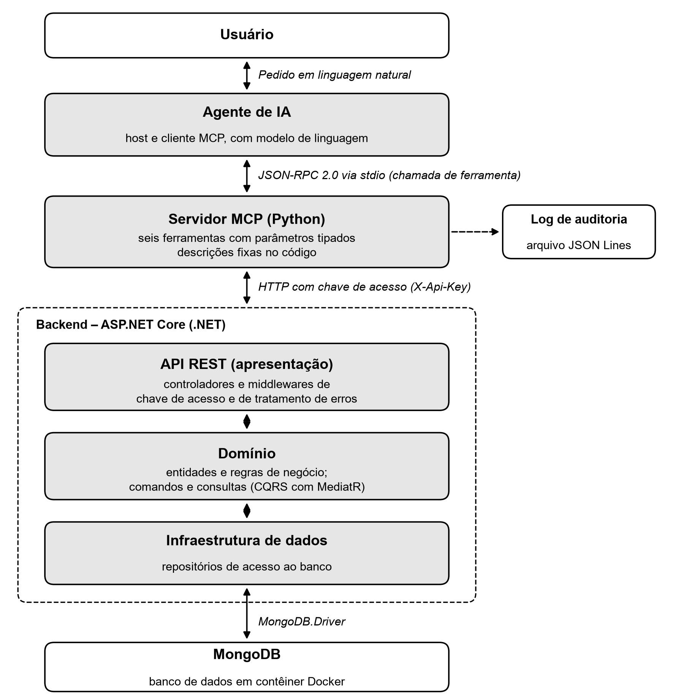

# Integração de sistemas de gerenciamento de dados com agentes de IA utilizando Model Context Protocol

Código-fonte, testes e evidências do Trabalho de Conclusão de Curso de **Bacharelado em Ciência da Computação** da **Universidade Paulista (UNIP) – Araraquara/SP, 2026**.

- **Autor:** Henrique Augusto Cicone Rossin
- **Orientador:** Prof. M.e João Paulo Santos

## Sobre o projeto

Um sistema de gestão de tarefas de equipe é disponibilizado a um agente de Inteligência Artificial por meio do **Model Context Protocol (MCP)**. Pessoas sem conhecimento técnico passam a consultar e operar o sistema em linguagem natural ("quais tarefas do João estão pendentes?"), algo que antes exigia uma ferramenta como o Postman, a chave da API e conhecimento de HTTP.

O foco do trabalho é que essa integração seja **segura, controlada e rastreável**: o agente só consegue fazer o que lhe foi explicitamente permitido, e tudo o que ele faz fica registrado.



```
Agente de IA  →  Servidor MCP (Python)  →  API REST (ASP.NET Core)  →  Domínio  →  MongoDB
```

Cada camada conversa apenas com a vizinha. O agente **não acessa o banco de dados**, e o servidor MCP também não: ele só faz requisições HTTP à API e devolve ao agente o que a API retornou.

## Como a segurança aparece no código

| Mecanismo | Onde está | Cenário de teste |
|---|---|---|
| **Menor privilégio:** só 6 ferramentas expostas ao agente; exclusão de tarefas e cadastro de membros existem na API, mas não têm ferramenta | `mcp-server/servidor.py` | 6 e 7 |
| **Validação de parâmetros:** status e prioridade só aceitam valores do domínio; IDs precisam ter o formato do backend | `mcp-server/servidor.py` | 5 |
| **Regras de negócio no domínio:** ex.: tarefa concluída não pode ser reaberta | `backend/src/Tarefas.Domain/Entities/Tarefa.cs` | 4 |
| **Controle de acesso:** toda rota `/api` exige o cabeçalho `X-Api-Key` | `backend/src/Tarefas.Api/Middlewares/ApiKeyMiddleware.cs` | 8 |
| **Descrições fixas e versionadas** das ferramentas (mitigação de *tool poisoning*) | `mcp-server/servidor.py` | 10 |
| **Auditoria:** toda chamada do agente, inclusive as recusadas, vira uma linha em JSON Lines | `mcp-server/auditoria.py` | 11 |
| **Dados sensíveis:** CPF e senha dos membros ficam só no banco (a senha apenas como hash PBKDF2 com *salt*) e nunca saem da API | `backend/src/Tarefas.Domain/Entities/Membro.cs`, `Helpers/SenhaHash.cs`, `DTOs/MembroDto.cs` | 12 |

A lista completa dos cenários está em [`docs/modelagem.md`](docs/modelagem.md).

## Estrutura do repositório

```
backend/         API REST em ASP.NET Core (.NET 10), CQRS com MediatR e MongoDB
mcp-server/      Servidor MCP em Python (SDK oficial, transporte stdio) com auditoria
docs/
  modelagem.md   Domínio, endpoints, ferramentas e cenários de teste
  postman/       Coleção de testes da API (35 requisições com testes automatizados)
  evidencias/    Prints e registros da execução dos testes
docker-compose.yml   MongoDB 8
.env.example         Configuração usada pelo servidor MCP
```

## Pré-requisitos

- [.NET 10 SDK](https://dotnet.microsoft.com/download)
- [Docker](https://docs.docker.com/get-docker/) com Docker Compose (para o MongoDB)
- [uv](https://docs.astral.sh/uv/) (instala o Python 3.12 e as dependências do servidor MCP)
- Para os testes da API: [Postman](https://www.postman.com/) ou o Newman (`npx newman`, exige Node.js)
- Para conversar com o agente: um cliente MCP, como o [Claude Desktop](https://claude.ai/download)

## Como executar

```bash
# 1. Configuração (o .env não é versionado)
cp .env.example .env

# 2. Banco de dados
docker compose up -d

# 3. API (em http://localhost:5080). O --reset recria o banco com os dados de exemplo.
dotnet run --project backend/src/Tarefas.Api -- --reset
```

Com a API no ar, em outro terminal:

```bash
# 4. Testes da API (equivalente ao "Run collection" do Postman)
npx newman run docs/postman/TCC-Tarefas-API.postman_collection.json

# 5. Teste do servidor MCP sem o agente (lista as ferramentas e faz consultas)
cd mcp-server
uv run testar_servidor.py
```

Para conectar o agente, veja [`mcp-server/README.md`](mcp-server/README.md#conectar-ao-claude-desktop).

> A chave `dev-chave-local-tcc` (em `appsettings.Development.json` e no `.env.example`) serve apenas para desenvolvimento local.

## Dados de exemplo

Em ambiente de desenvolvimento, a API cria 4 membros (Ana Souza, Bruno Lima, Carla Mendes e João Pereira) e 12 tarefas. Os CPFs são **fictícios**, válidos apenas pelos dígitos verificadores. As senhas são geradas aleatoriamente e descartadas logo após o cálculo do hash, de modo que nem o código-fonte nem o banco as conhecem.

## Resultados dos testes

- **API REST:** a coleção do Postman foi executada em 04/10/2026, com 32 requisições e 64 testes aprovados. Depois da inclusão do CPF e da senha, a coleção atual (35 requisições, 72 testes) passou sem nenhuma falha pelo Newman, em 19/10/2026, e pelo Postman Runner, em 26/10/2026.
- **Agente:** os cenários 1 a 11 foram executados em 04/10/2026 e o cenário 12 em 26/10/2026, no Claude Desktop, com o modelo Claude Opus 5.5.

Os prints, os relatórios e o registro de auditoria estão em [`docs/evidencias`](docs/evidencias/README.md).
